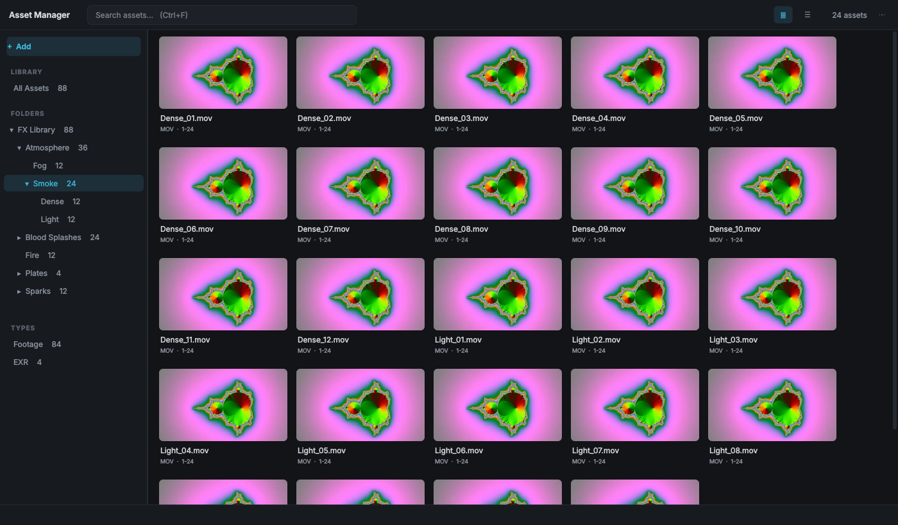

# Asset Manager for Nuke

A fast asset browser that lives inside Nuke. Point it at your stock footage,
FX elements, plates and textures, browse them as thumbnails, scrub videos by
hovering, and drag them straight into the Node Graph.

**Works on Nuke Indie.** Indie only lets Python touch about 10 nodes per
session. Asset Manager creates and sets up nodes through TCL instead, so you can
import as many assets as you like without hitting that limit.

## Features

- **Library of folders**: add a folder once and its subfolders appear as a tree you can expand and collapse
- **Thumbnails** for video, image sequences, EXR, DPX, PNG and JPG. Sequences and clips use the middle frame, not a black first frame
- **Hover scrub**: move the mouse across a video card to preview the clip
- **Drag & drop** to the Node Graph, **double-click**, or **Enter** to create Read nodes with the right frame range
- **Filters**: by folder, subfolder and type, plus search (Ctrl+F)
- **Grid or list view** with adjustable thumbnail size
- **Missing files** show in red and can be removed from the library in one click
- **Image sequences** detected automatically (`name.1001.exr`, `name_0001.png`)
- Remembers window size, layout and open folders
- **Automatic update check**: updates from GitHub download only the changed files
- No extra Python packages: only what ships with Nuke, plus ffmpeg for video thumbnails

## Requirements

- Nuke 13 or newer (Indie, NukeX, Nuke Studio), Windows
- [Python 3](https://www.python.org/downloads/) on the machine, to run the installer
- ffmpeg, which the installer can download for you. Without it everything works except video, EXR and DPX thumbnails

## Install

1. Download this repository: **Code → Download ZIP**, then extract it
2. Double-click **`install.pyw`**
3. Check the list, then click **Install / Update**. If ffmpeg is missing, click **Download ffmpeg**
4. Restart Nuke and open **DMB Tools → Asset Manager**

The installer copies the `Asset Manager` folder into `~/.nuke/` and adds a
**DMB Tools** menu to `~/.nuke/menu.py`. It backs up `menu.py` first and never
adds the entry twice. Running it again updates the plugin and keeps your library.

## Updating

The first time you open Asset Manager in a Nuke session, it quietly checks
GitHub in the background. If a newer version exists, a small window offers
**Update Now**. If you're up to date or offline, nothing appears.

You can also update at any time:

- **Inside Nuke**: **⋯ → Check for Updates...** in the Asset Manager window
- **Installer**: click **Update from GitHub**

Only the files that changed are downloaded, and files removed from the project
are deleted. Your library (`data/`) and ffmpeg (`bin/`) are never touched.
Restart Nuke after updating.

Menu changes arrive with updates too: if your `menu.py` has an Asset Manager
entry from an older version, the plugin replaces it by itself (with a backup)
and asks you to restart Nuke.

### Manual install

Copy the `Asset Manager` folder into `C:\Users\<you>\.nuke\`, put `ffmpeg.exe`,
`ffprobe.exe` and `ffplay.exe` into `Asset Manager\bin\`, and paste the block
between `# ---- Asset Manager: START` and `END` from `install.pyw` at the end of
your `menu.py`.

## Where things are

| Path | What |
|---|---|
| `~/.nuke/Asset Manager/` | the plugin |
| `~/.nuke/Asset Manager/bin/` | ffmpeg, ffprobe, ffplay |
| `~/.nuke/Asset Manager/data/` | your library: database, thumbnails, settings (kept on update) |

## Troubleshooting

To see detailed logs in the Script Editor, set the environment variable
`ASSET_MANAGER_DEBUG=1` before launching Nuke.

## Author

**Daniel Marinho Borel**, VFX compositor and pipeline developer.
Contact: [danielmborel@gmail.com](mailto:danielmborel@gmail.com)

Bug reports and ideas are welcome. Open an issue here on GitHub or send an email.

## License

MIT. See [LICENSE](LICENSE).
